<div align="center">

# iTerminal

**An SSH terminal with a built-in AI ops assistant** — terminal, files, monitoring, batch execution and an AI Agent in one desktop app.<br/>
The AI can investigate and act for you, but every command goes through risk analysis and permission control, and credentials never reach the model.

**English** · [简体中文](README.zh-CN.md)

[](LICENSE)


</div>

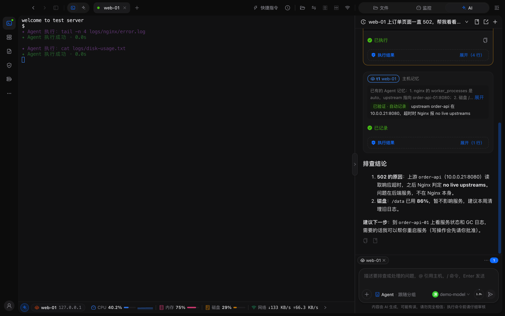

> The UI is currently in Simplified Chinese.

## Contents

- [Highlights](#highlights)
- [Screenshots](#screenshots)
- [Features](#features)
- [MCP server: let Claude Code / Codex / Cursor operate your servers](#mcp-server-let-claude-code--codex--cursor-operate-your-servers)
- [Download](#download)
- [Build from source](#build-from-source)
- [Deploy the backend (optional)](#deploy-the-backend-optional)
- [Project layout](#project-layout)
- [Security](#security)
- [License](#license)

## Highlights

- **Works locally out of the box** — no backend, no sign-up. Hosts, passwords and private keys stay in a local SQLCipher-encrypted database.
- **AI next to your terminal** — the AI panel references the current terminal by default; or switch to the full-page AI chat and target hosts with `@host` without opening a terminal.
- **Every command is risk-checked** — commands are parsed with tree-sitter (including commands nested in `sudo`, `sh -c`, `ssh host 'cmd'`) and classified as read-only / caution / high-risk / denied. Three Agent permission levels (**Read-only / Auto / Full access**); production groups, deny-lists and per-host deny-lists always apply.
- **An Agent that remembers** — host memory (written by you, plus facts the Agent has verified) and **group notes** (inherited down nested groups as context for every host in the group).
- **Credentials never leave your machine** — secrets are masked before anything is sent to a model (private keys, passwords, cloud AKs, tokens, phone and ID numbers), and external Agents using the MCP server never see credentials either.
- **Fully auditable** — every connection is recorded (encrypted), and every command is attributed to you, the AI Agent, a Skill or an external Agent, with one-click replay.

## Screenshots

| | |
|---|---|
| 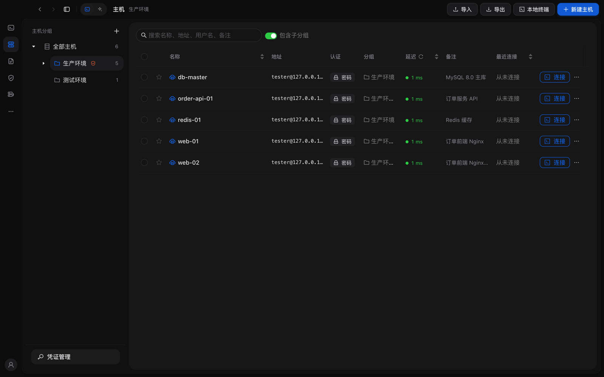 Host groups with inherited settings | 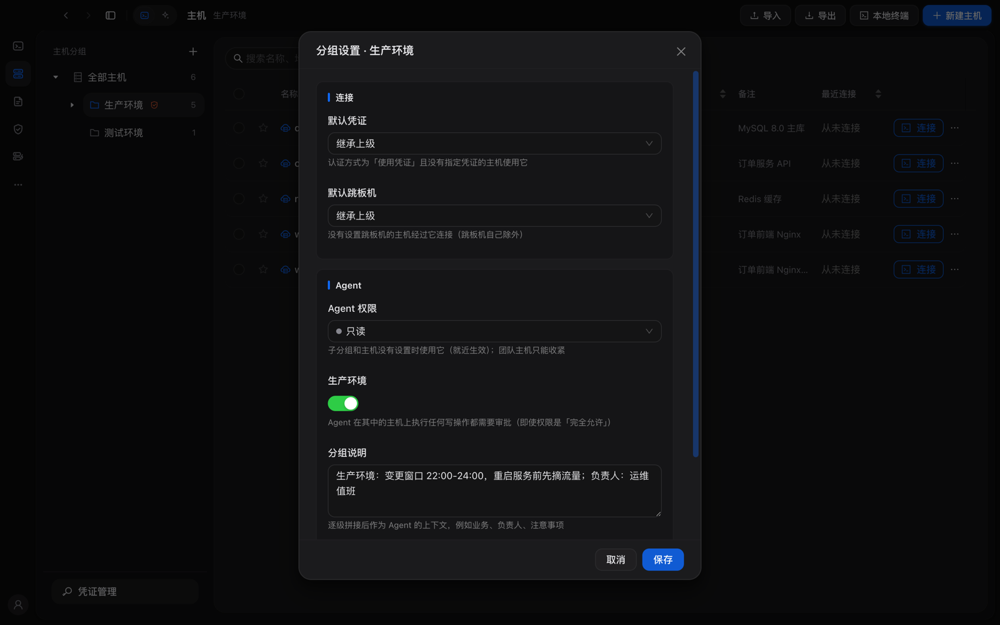 Group settings: Agent permission, production flag, **group notes** (group memory) |
| 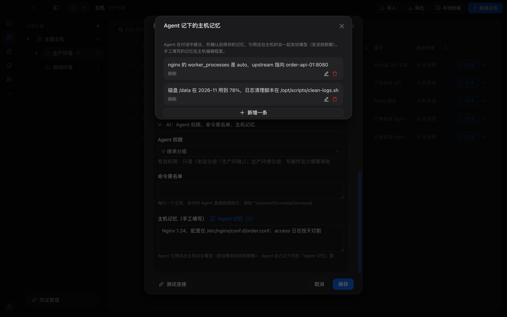 **Host memory**: your notes + what the Agent recorded | 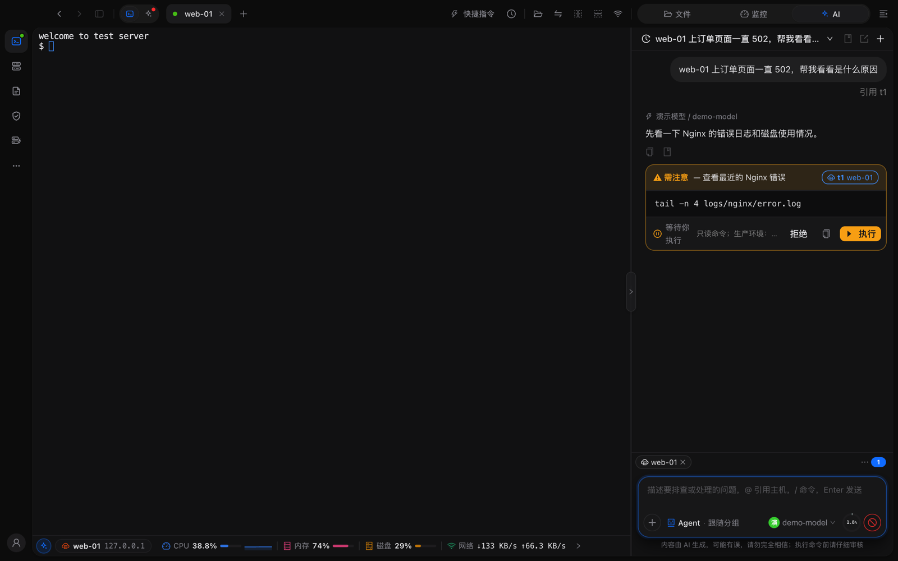 Each command explains its purpose and risk; production needs your confirmation |
| 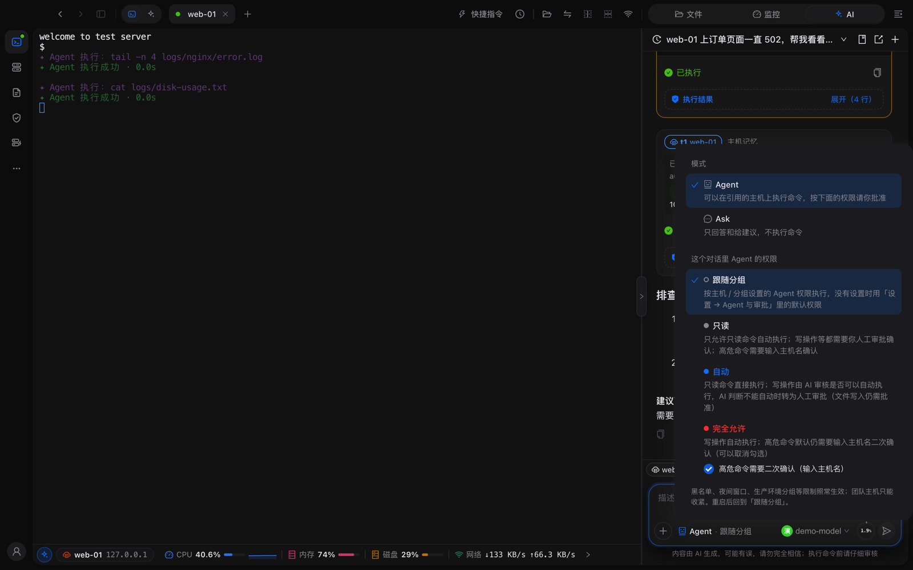 Switch Agent permission per conversation | 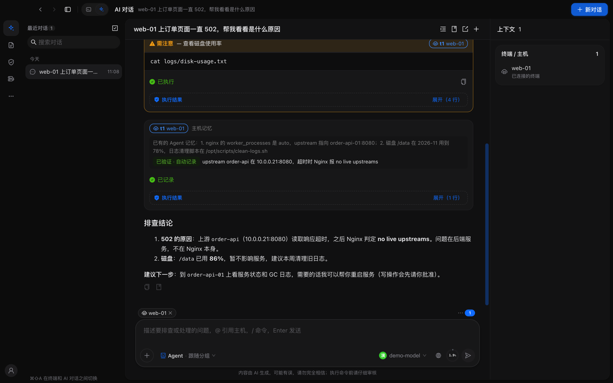 Full-page AI chat with history and context |
| 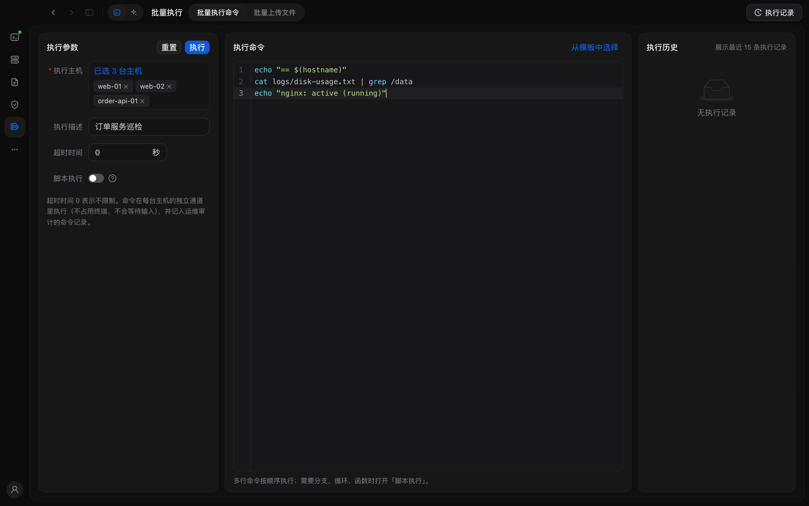 Batch command execution, templates from snippets | 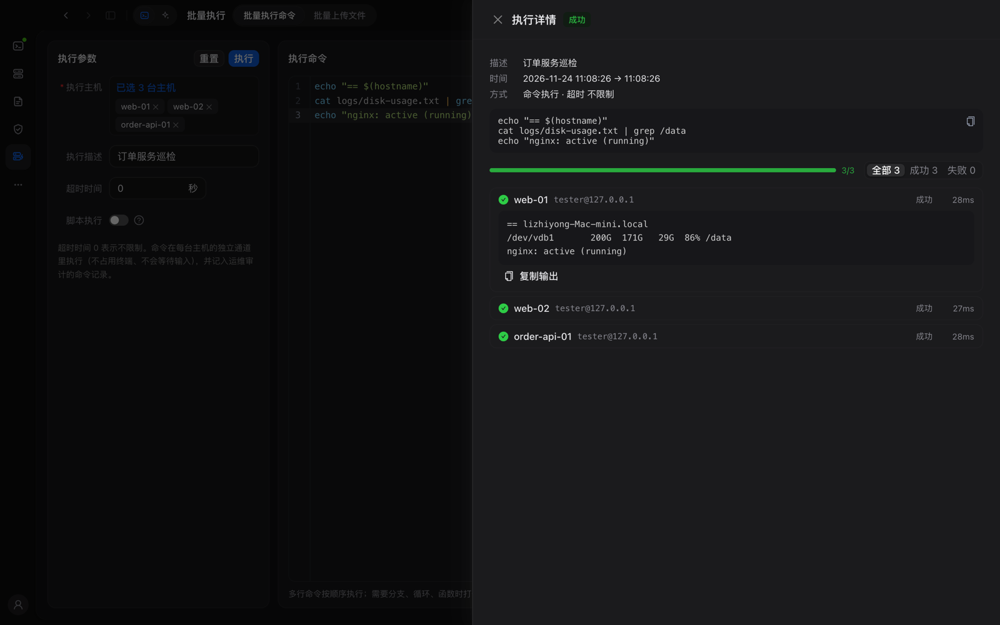 Live per-host status, output and timing |
| 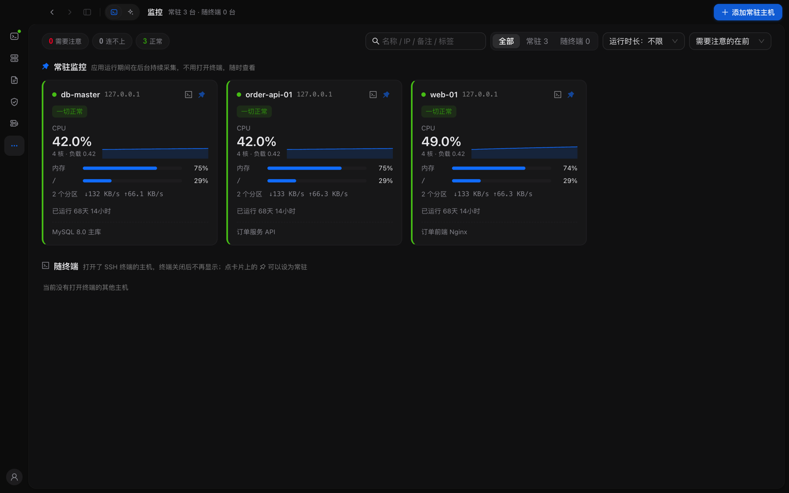 Agentless monitoring over SSH | 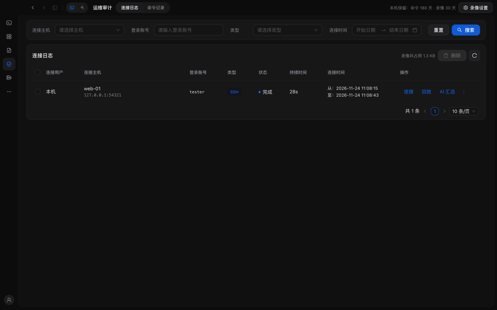 Audit: connection log (login user, start/end, replay) |
| 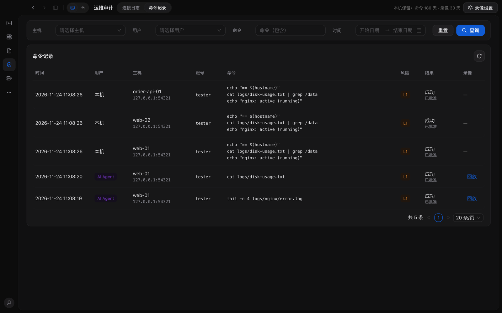 Command log: manual / AI Agent / external Agent, replay | 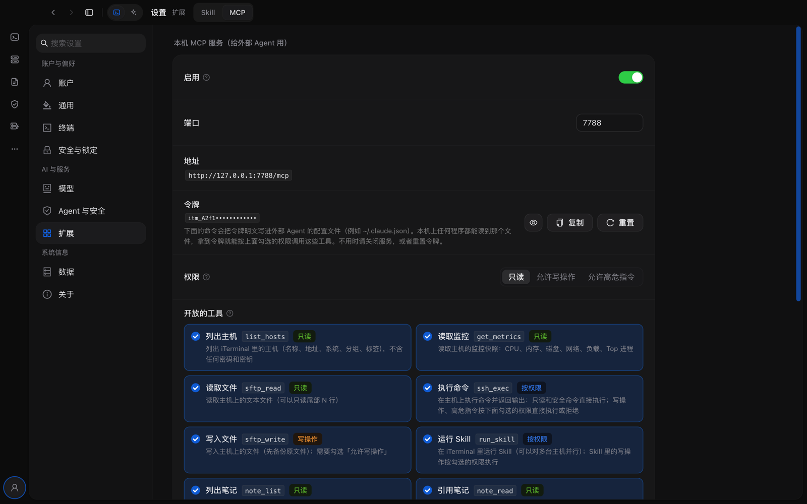 Local MCP server for external Agents |

> All screenshots use demo data.

## Features

### Terminal & files

- SSH, Telnet, serial and local shell; tabs, split panes, broadcast input, drag-to-reorder tabs, press R to reconnect.
- Multi-hop jump hosts, SOCKS5 / HTTP proxies, 2FA bastions (TOTP auto-fill), host-key verification.
- File panel that follows the terminal's working directory: upload, download, drag & drop, resume, in-place editing; falls back to an SSH command channel or FTP when SFTP is unavailable.
- Port forwarding (-L / -R / -D), importable from a pasted `ssh -L …` command.
- Command suggestions (host history + 272 annotated common commands + snippets), output highlighting, in-terminal search, color schemes, background images.
- Live monitoring in the status bar and side panel (CPU, memory, GPU, disks, network, processes, ports, large files) with nothing installed on the server.

### Hosts & credentials

- Nested host groups; group settings (default credential, default jump host, Agent permission, production flag, group notes, default Skills) are inherited.
- Import from `~/.ssh/config`, Xshell, SecureCRT, FinalShell, MobaXterm, Electerm and CSV.
- Credential vault: passwords, SSH keys, TOTP, cloud AKs, database accounts, certificates; key generation, bulk public-key deployment, key rotation, expiry reminders, "never share with AI".
- Optional master password (Argon2id), Touch ID, auto-lock.

### AI Agent

- **Two ways to use it**: the AI panel beside the terminal (references the current terminal), or the full-page AI chat (`@host` to target servers; the Agent runs commands on a background channel, still recorded).
- **Agent / Ask modes** — Ask only answers, never executes.
- **References**: `@` hosts, terminals, groups, notes, knowledge base, Skills, MCP; `/` to run Skills or insert snippets; paste screenshots and files.
- **Command approval** — every command shows its purpose and risk level. Three permission levels:
  - **Read-only**: read-only commands run automatically; writes wait for your approval;
  - **Auto**: writes are reviewed by AI and run automatically when judged safe, otherwise escalated to you;
  - **Full access**: writes run automatically; high-risk commands still require typing the host name by default (can be turned off).
- **Host memory / group notes** — host memory has a manual part and an Agent part; the Agent records verified facts automatically and asks before saving uncertain ones (skipped after 10 seconds without confirmation). Group notes are concatenated down the group tree as context.
- **More**: type `#` at the start of a terminal line to ask AI; explain selected output; save answers or whole conversations as notes (AI-summarized); summarize a session recording into a troubleshooting note; web search; parallel read-only tool calls; context usage ring and auto-compaction.
- **Models**: DeepSeek, Qwen, GLM, Kimi, Doubao, MiniMax, Claude, OpenAI, Gemini, OpenRouter, local Ollama and any OpenAI-compatible API, with reasoning effort mapped per model. Bring your own API key — no account needed.
- **Skills**: describe multi-step runbooks in `SKILL.md` and run them across many hosts or a whole group in parallel; write steps are merged into a single approval card.

### Batch execution

- **Batch commands**: pick hosts, write a command or choose a snippet template; set a timeout or run as a script; live per-host output and exit codes, cancellable; risk check before running, deny-listed hosts are skipped.
- **Batch upload**: upload files / folders to many hosts; target paths support `${username}` and `${home}`, missing directories are created.
- Searchable history with details and re-run; every command is recorded in the audit log.

### Audit

- **Connection log**: one entry per connection with login user, start / end time and duration; reconnect, replay or AI-summarize.
- **Command log**: every command run manually, by the AI Agent, by a Skill or by an external Agent (MCP), with risk level, result and a link to the matching recording.
- Recordings are asciicast v2, chunk-encrypted with AES-256-GCM; keyboard input is never recorded (so typed passwords are not captured).

### More

- Database assets and a SQL workbench (MySQL / PostgreSQL / SQLite) with AI-written SQL and plan explanation; writes require confirmation.
- Snippets with `{{variables}}`, Markdown notes (import Markdown / Word), monitoring dashboard with history for pinned hosts.
- Encrypted local backup export / import; with the backend: multi-device sync, share codes, team hosts and models, knowledge base, remote approvals.

## MCP server: let Claude Code / Codex / Cursor operate your servers

iTerminal can run a local [MCP](https://modelcontextprotocol.io) server that exposes "operate my servers" to other Agent tools (Claude Code, Codex, Cursor, WorkBuddy, …). **External Agents only see host names, addresses, groups and tags — never passwords, private keys or tokens.** iTerminal handles connections, authentication and jump hosts.

- Listens on `127.0.0.1` only, Streamable HTTP, Bearer token, Host / Origin validation against DNS rebinding.
- Tools: `list_hosts`, `ssh_exec`, `sftp_read`, `sftp_write`, `get_metrics`, `run_skill`, `note_list` / `note_read` / `note_save`, `skill_list` / `skill_read` / `skill_save`, `kb_search` — each can be enabled individually.
- Three permission levels: **read-only** (only read-only / safe commands) / **allow writes** / **allow high-risk**; deny-lists, production groups and per-host deny-lists still apply.
- Every command run by an external Agent is in the audit log, attributed to "external Agent".

Enable it in *Settings → Extensions → MCP*, copy the URL and token, then add it to your tool:

**Claude Code**

```bash
claude mcp add --transport http iterminal http://127.0.0.1:7788/mcp --header "Authorization: Bearer <token>"
```

**Cursor / WorkBuddy / other tools with remote MCP support** (`mcpServers` config, e.g. Cursor's `~/.cursor/mcp.json`)

```json
{
  "mcpServers": {
    "iterminal": {
      "url": "http://127.0.0.1:7788/mcp",
      "headers": { "Authorization": "Bearer <token>" }
    }
  }
}
```

**Codex and stdio-only tools** (bridged with [mcp-remote](https://www.npmjs.com/package/mcp-remote), e.g. Codex's `~/.codex/config.toml`)

```toml
[mcp_servers.iterminal]
command = "npx"
args = ["-y", "mcp-remote", "http://127.0.0.1:7788/mcp", "--header", "Authorization: Bearer <token>"]
```

> Once written into a tool's config file the token is plain text that any local program can read. Turn the server off when not in use, or reset the token in Settings.

## Download

Get the installers from [Releases](../../releases):

| OS | File |
|---|---|
| macOS (Apple silicon) | `iTerminal-<version>-arm64.dmg` |
| macOS (Intel) | `iTerminal-<version>.dmg` |
| Windows (x64) | `iTerminal-Setup-<version>.exe` |

- Release builds contain **no backend address** — they start in local-only mode. Deploy your own backend for team features (see below).
- Builds are not notarized / code-signed:
  - macOS: if it says the app is "damaged" or from an unidentified developer, run `xattr -cr /Applications/iTerminal.app` and open it again;
  - Windows: on the SmartScreen prompt choose "More info → Run anyway".

First steps: add a model in *Settings → Models* (an API key, or a local Ollama), then add your servers on the *Hosts* page.

## Build from source

**Requirements**

- Node.js ≥ 22.12 and pnpm 10 (`corepack enable` picks the version pinned in `package.json`)
- Native modules (node-pty, SQLCipher, serialport) need a toolchain: Xcode Command Line Tools on macOS; Visual Studio Build Tools (C++) and Python 3 on Windows; `build-essential` and Python 3 on Linux

**Develop**

```bash
pnpm install
pnpm dev:desktop          # run the app in development
pnpm typecheck
pnpm test                 # unit tests (Vitest)
pnpm e2e                  # end-to-end tests (Playwright + Electron)
```

**Package**

```bash
pnpm --filter @itm/desktop dist:mac        # macOS: dmg + zip (arm64, x64)
pnpm --filter @itm/desktop dist:win        # Windows: NSIS + MSI (run on Windows)
pnpm --filter @itm/desktop dist:win:cross  # cross-build a Windows NSIS installer on macOS (unsigned)
pnpm --filter @itm/desktop dist:linux      # Linux: AppImage + deb + rpm
```

Output goes to `apps/desktop/release/<version>/`. Without a signing certificate, package macOS with an ad-hoc signature:

```bash
cd apps/desktop && npx electron-vite build && npx electron-builder --mac -c.mac.identity=-
```

**Default backend address (optional)**: the repository contains no backend address. To make your own builds connect to your backend by default, copy `.env.example` to `.env` (git-ignored):

```bash
ITM_DEFAULT_SERVER_URL=https://ops.example.com/prod-api
```

Leave it unset for local-only builds. An installed client can also change the address in *Settings → About* (click the app icon 5 times, then enter the admin password), or via managed configuration for fleet rollout (Windows registry `HKLM\Software\iTerminal\ServerUrl`, macOS managed preference `ServerUrl` in `com.corp.iterminal`, Linux `/etc/iterminal/config.json`).

## Deploy the backend (optional)

The backend lives in [`server/`](server/). It is based on [RuoYi-Vue](https://gitee.com/y_project/RuoYi-Vue) (Spring Boot 3.5, JDK 17, MySQL 8, Redis 7) and includes a Vue 3 admin console. It provides accounts and devices, team hosts and models, a knowledge base, remote approvals, audit and recording upload, cloud backup and sharing, and client release distribution. **Not needed for local use.**

### Docker Compose (recommended)

```bash
cd server/deploy
cp .env.example .env          # fill in passwords and secrets
docker compose up -d --build
```

Required values in `.env` (generate with `openssl rand -hex 32`):

| Variable | Purpose |
|---|---|
| `MYSQL_ROOT_PASSWORD` / `DB_PASSWORD` | MySQL root password / password of the `itm` DB user |
| `TOKEN_SECRET` | JWT signing key (≥ 32 chars; the backend refuses to start without it) |
| `ITM_DATA_KEY` | Encrypts team model API keys and team host passwords — **never change it after setup** |
| `DRUID_PASSWORD` | Password for the Druid monitoring page |
| `HTTP_PORT` | Public port, default 80 |

This starts four containers: `mysql`, `redis`, `backend` (Spring Boot) and `nginx` (admin console + reverse proxy of `/prod-api/` to the backend).

- Admin console: `http://<server>:HTTP_PORT/`, initial account `admin` / `admin123` — **you are asked to change the password on first login**.
- Server address for the desktop client: `http://<server>:HTTP_PORT/prod-api`.
- Slow builds in mainland China: enable `MAVEN_MIRROR` / `NPM_REGISTRY` in `.env`.

### Database initialization

With an empty data volume, the MySQL container runs these scripts in order on first start:

| Order | Script | Contents |
|---|---|---|
| 1 | [`server/sql/ry_20260417.sql`](server/sql/ry_20260417.sql) | RuoYi base tables (users, roles, menus, dictionaries, config) |
| 2 | [`server/sql/quartz.sql`](server/sql/quartz.sql) | Quartz scheduler tables |
| 3 | [`server/sql/iterminal.sql`](server/sql/iterminal.sql) | iTerminal tables (`itm_` prefix), menus and permissions, dictionaries, defaults, sample command rules |

For a manual setup run them in the same order (they drop and recreate tables — initialization only):

```bash
mysql -uroot -p -e "CREATE DATABASE iterminal DEFAULT CHARSET utf8mb4 COLLATE utf8mb4_general_ci"
mysql -uroot -p iterminal < server/sql/ry_20260417.sql
mysql -uroot -p iterminal < server/sql/quartz.sql
mysql -uroot -p iterminal < server/sql/iterminal.sql
```

`server/sql/iterminal-upgrade-*.sql` are idempotent upgrade scripts for **existing** databases only; fresh installs don't need them.

### Without Docker

```bash
cd server
mvn -DskipTests package                      # builds ruoyi-admin/target/ruoyi-admin.jar
DB_HOST=127.0.0.1 DB_USER=itm DB_PASSWORD=... REDIS_HOST=127.0.0.1 \
TOKEN_SECRET=$(openssl rand -hex 32) ITM_DATA_KEY=... \
java -jar ruoyi-admin/target/ruoyi-admin.jar

cd ruoyi-ui && npm install && npm run build:prod   # static admin console in dist/; serve with Nginx and proxy /prod-api/ to :8080
```

All settings, an Nginx example and upgrade notes are in [`server/README-iTerminal.md`](server/README-iTerminal.md) (Chinese).

## Project layout

```
.
├── apps/desktop/          # Desktop client: Electron 44 + React 19 + Ant Design 6
│   ├── src/main/          #   main process: SSH pool, SFTP, recordings, approval engine, MCP server, batch execution…
│   ├── src/agent/         #   the Agent runs in a separate utility process
│   ├── src/renderer/      #   UI
│   ├── test/ · e2e/       #   unit tests (Vitest) · end-to-end tests (Playwright)
├── packages/
│   ├── protocol/          # shared types and IPC definitions
│   ├── agent-core/        # Agent loop, tool definitions, system prompt
│   ├── approval/          # command risk classification (tree-sitter-bash)
│   ├── masking/           # secret masking before sending to models
│   └── sync-merge/        # backup / sync merging
├── server/                # backend (RuoYi-Vue, Spring Boot 3) + admin console + Docker deployment
└── docs/images/           # README screenshots
```

## Security

- The local database is encrypted with SQLCipher, with its key in the OS keychain (optional master password); session recordings are chunk-encrypted.
- The Agent runs in a separate process; every tool call goes back to the main process for approval, execution and auditing. Tool output is treated as untrusted to resist prompt injection.
- Please report vulnerabilities privately via GitHub Security Advisories rather than public issues.

## License

[MIT](LICENSE). The backend in `server/` is based on [RuoYi-Vue](https://gitee.com/y_project/RuoYi-Vue) (MIT, see [`server/LICENSE`](server/LICENSE)).
