<div align="center">

# iTerminal

**带 AI 运维助手的 SSH 终端** —— 终端、文件、监控、批量执行和 AI Agent 放在一个桌面应用里，<br/>
AI 能帮你排查、执行，但每一条命令都经过风险判定和权限控制，凭证永远不交给模型。

[English](README.md) · **简体中文**

[](LICENSE)


</div>

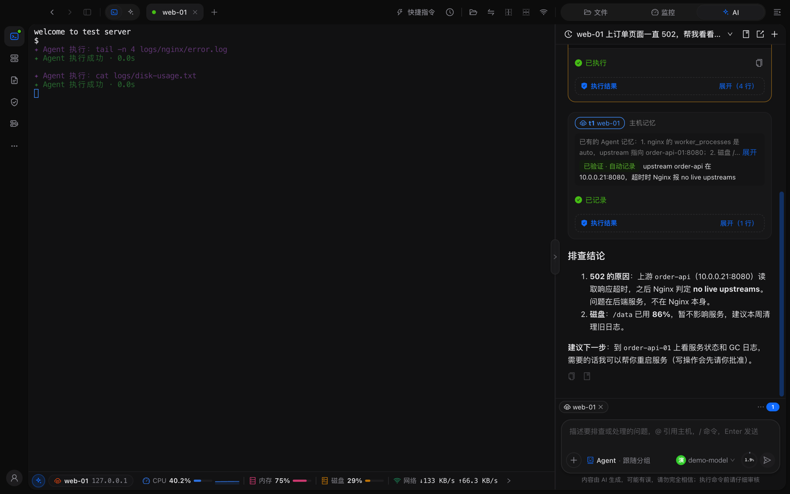

## 目录

- [亮点](#亮点)
- [截图](#截图)
- [功能](#功能)
- [作为 MCP 服务：让 Claude Code / Codex / Cursor 操作服务器](#作为-mcp-服务让-claude-code--codex--cursor-操作服务器)
- [下载安装](#下载安装)
- [从源码编译打包](#从源码编译打包)
- [部署后端（可选）](#部署后端可选)
- [项目结构](#项目结构)
- [安全说明](#安全说明)
- [开源协议](#开源协议)

## 亮点

- **开箱即用的本地模式**：不需要后端、不需要注册。主机、密码、私钥只保存在本机的 SQLCipher 加密数据库里。
- **AI 在终端旁边**：右侧 AI 面板默认引用当前终端；也可以切到整页 AI 对话，用 `@主机` 直接指定目标，不用先开终端。
- **每条命令都有风险判定**：tree-sitter 解析 Shell，展开 `sudo` / `sh -c` / `ssh 主机 '命令'` 里嵌套的命令，分成只读 / 需注意 / 高危 / 禁止；Agent 权限三档（**只读 / 自动 / 完全允许**），生产环境分组、命令黑名单、主机黑名单始终生效。
- **会记事的 Agent**：主机记忆（手工填写 + Agent 验证过的自动记录）和**分组说明**（逐级拼接，作为这个分组所有主机的上下文），越用越懂你的环境。
- **凭证不出本机**：发给模型前自动脱敏（私钥、密码、AK、Token、手机号、身份证等），外部 Agent 通过 MCP 操作服务器时也拿不到任何凭证。
- **全程可审计**：每次连接自动录像（加密保存），命令记录标明是手动、AI Agent、Skill 还是外部 Agent 执行的，能直接跳到录像回放。

## 截图

| | |
|---|---|
| 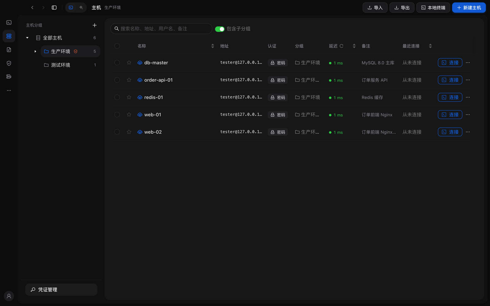 主机分组树，分组设置逐级继承 | 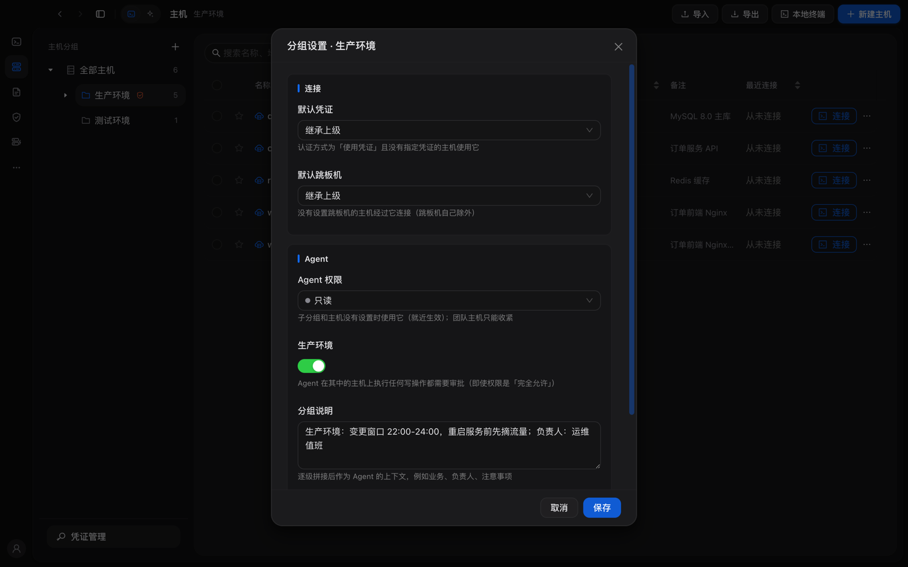 分组设置：Agent 权限、生产环境、**分组说明**（分组记忆） |
| 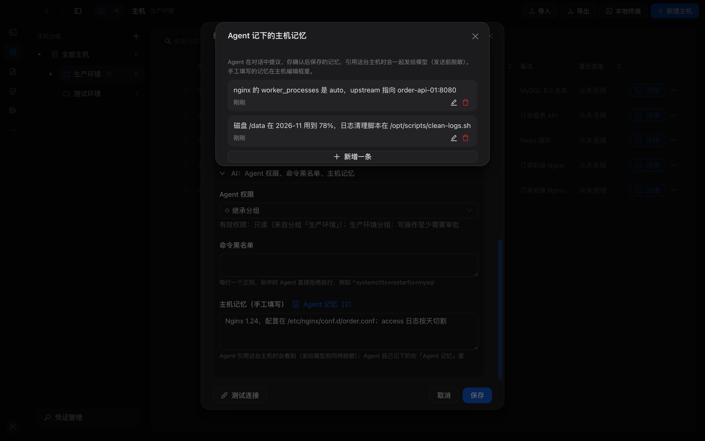 **主机记忆**：手工填写 + Agent 记下的记忆 | 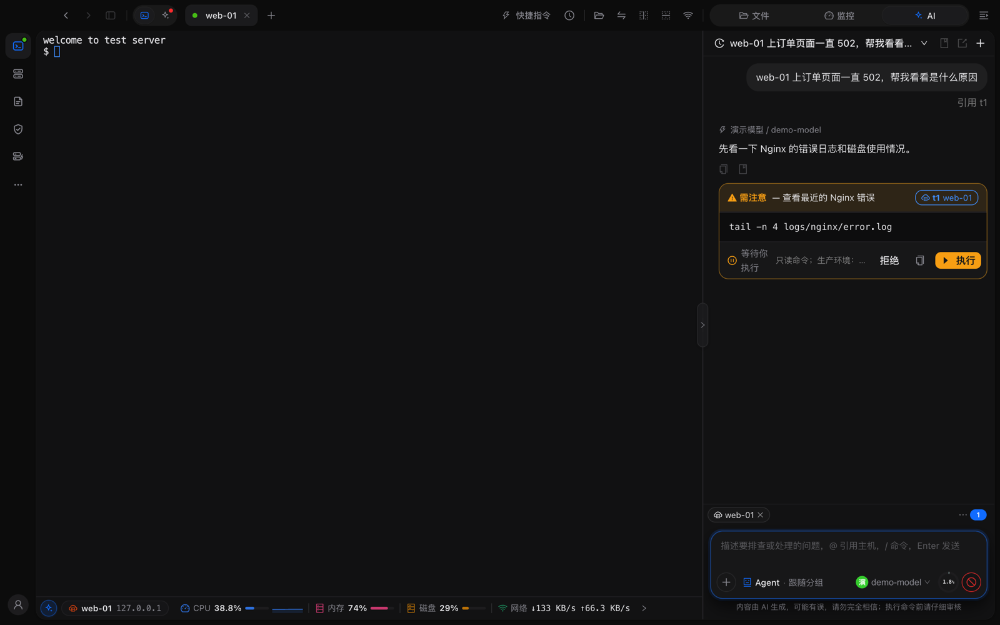 每条命令先说明作用和风险，生产环境需要你确认 |
| 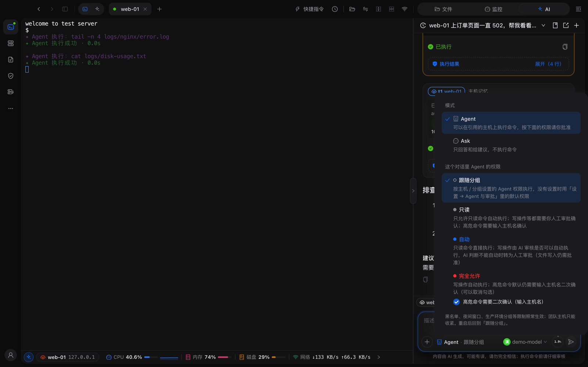 对话里随时切换 Agent 权限 | 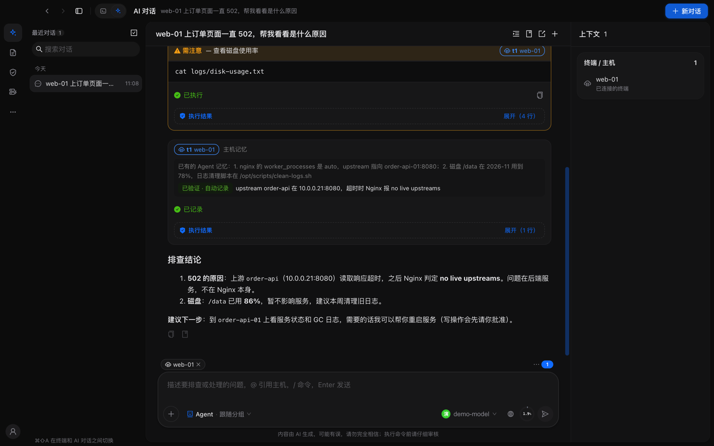 整页 AI 对话：会话列表、上下文、引用 |
| 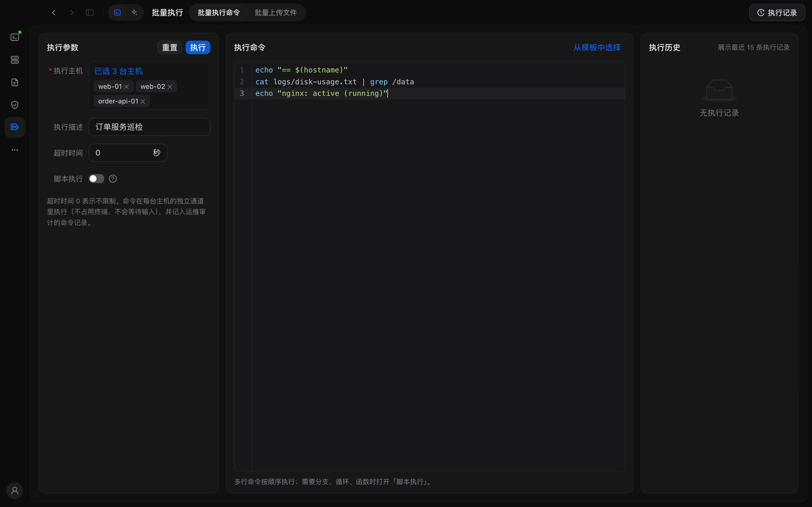 批量执行命令，可从指令集选模板 | 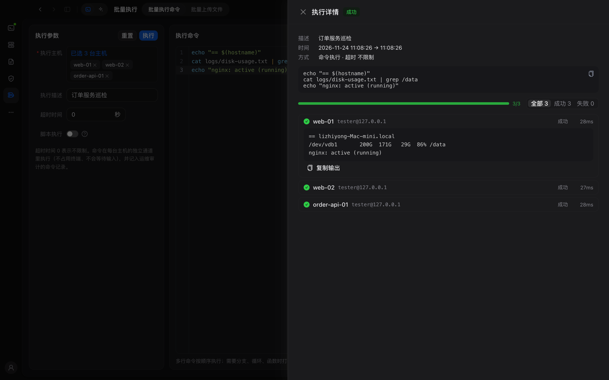 每台主机的状态、输出、耗时实时显示 |
| 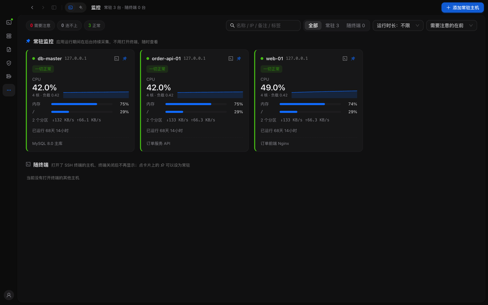 常驻监控：不装 Agent，通过 SSH 采集 | 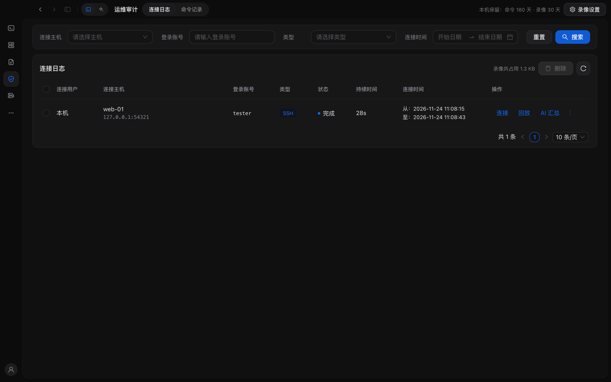 运维审计：连接日志（登录账号、起止时间、回放） |
| 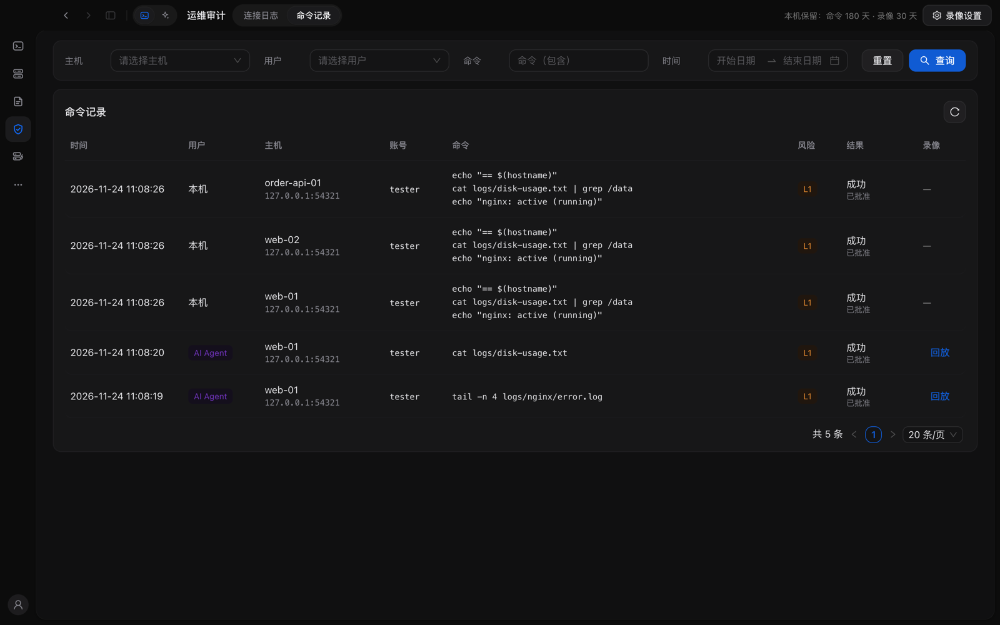 命令记录：手动 / AI Agent / 外部 Agent，一键回放 | 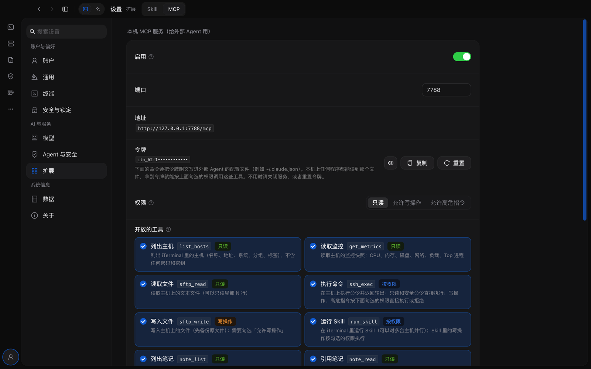 本机 MCP 服务：把服务器交给外部 Agent |

> 截图里都是演示数据。

## 功能

### 终端与文件

- SSH、Telnet、串口、本地 Shell；多标签、分屏、广播输入、标签拖动排序、断线按 R 重连。
- 跳板机（多级）、SOCKS5 / HTTP 代理、两步验证堡垒机（TOTP 自动填写）、主机指纹校验。
- 文件面板跟随终端当前目录：上传、下载、拖拽、断点续传、在线编辑；没有 SFTP 时自动改用 SSH 命令通道或 FTP。
- 端口转发（-L / -R / -D），可以直接粘贴 `ssh -L …` 命令导入。
- 命令提示（本机历史 + 272 条带中文说明的常用命令 + 指令集）、输出高亮、终端内搜索、配色方案、背景图片。
- 实时监控：终端底部状态栏和右侧面板（CPU、内存、显卡、磁盘、网络、进程、端口、大文件），不在服务器上安装任何东西。

### 主机与凭证

- 多级主机分组；分组设置（默认凭证、默认跳板机、Agent 权限、生产环境、分组说明、默认 Skill）逐级继承。
- 从 `~/.ssh/config`、Xshell、SecureCRT、FinalShell、MobaXterm、Electerm、CSV 导入。
- 凭证保险库：密码、SSH 密钥、TOTP、云 AK、数据库账号、证书；生成密钥、批量部署公钥、密钥轮换、到期提醒、禁止 AI 引用。
- 可选主密码（Argon2id）、Touch ID、自动锁定。

### AI Agent

- **两种用法**：终端旁的 AI 面板（默认引用当前终端）和整页 AI 对话（`@主机` 指定目标，Agent 在后台通道执行，同样录像）。
- **Agent / Ask 两种模式**：Ask 只回答不执行。
- **引用**：`@` 引用主机、终端、分组、笔记、知识库、Skill、MCP；`/` 运行 Skill、插入快捷命令；可以粘贴截图和文件。
- **命令审批**：每条命令带「作用说明」和风险等级；Agent 权限三档：
  - **只读**：只读命令自动执行，写操作等你批准；
  - **自动**：写操作由 AI 审核，判断可以自动执行时直接执行，否则转人工审批；
  - **完全允许**：写操作自动执行，高危命令默认仍需输入主机名确认（可取消）。
- **主机记忆 / 分组说明**：主机记忆分手工填写和 Agent 记录两部分；Agent 记录时分「已验证 · 自动记录」和「不确定 · 10 秒内没确认就跳过」；分组说明逐级拼接，作为分组里所有主机的上下文。
- **更多**：终端里行首输入 `#` 直接问 AI；AI 解释选中的输出；回答 / 整段对话存为笔记（AI 汇总）；会话录像一键 AI 汇总成排障笔记；联网搜索；同一轮里的只读命令并行执行；上下文占用显示和自动压缩。
- **模型**：DeepSeek、通义千问、智谱 GLM、Kimi、豆包、MiniMax、Claude、OpenAI、Gemini、OpenRouter、本机 Ollama 以及任意 OpenAI 兼容接口；深度思考强度按模型自动适配。不登录也可以配置自己的 API Key 使用全部 AI 功能。
- **Skill**：用 `SKILL.md` 描述多步运维流程，可以对多台主机 / 整个分组并行运行，写操作合并成一张审批卡片。

### 批量执行

- **批量执行命令**：选择多台主机、填写命令或从指令集选模板，可设置超时、按脚本执行；每台主机的输出、退出码实时显示，可以取消；执行前检查风险，命中黑名单的主机不执行。
- **批量上传文件**：选择文件 / 文件夹上传到多台主机，路径支持 `${username}`、`${home}`，目录不存在时自动创建。
- 执行记录可筛选、查看详情、重新执行；每条命令都记入运维审计。

### 运维审计

- **连接日志**：每次连接一条，记录登录账号、开始和结束时间、时长，可以重新连接、回放、AI 汇总。
- **命令记录**：手动、AI Agent、Skill、外部 Agent（MCP）执行的每条命令，带风险等级和结果，能对应到录像的直接回放。
- 录像为 asciicast v2，分块 AES-256-GCM 加密；不记录键盘输入（避免记下密码）。

### 其他

- 数据库资产与 SQL 工作台（MySQL / PostgreSQL / SQLite），AI 写 SQL、解释执行计划，写操作需要确认。
- 指令集（支持 `{{变量}}`）、Markdown 笔记（导入 Markdown / Word）、监控看板（常驻主机后台采集，保存历史趋势）。
- 本地加密备份导入导出；登录服务端后支持多设备同步、分享码、团队主机、团队模型、知识库、远程审批。

## 作为 MCP 服务：让 Claude Code / Codex / Cursor 操作服务器

iTerminal 可以在本机提供一个 [MCP](https://modelcontextprotocol.io) 服务，把「操作服务器」的能力开放给其他 Agent 工具（Claude Code、Codex、Cursor、WorkBuddy 等）。**外部 Agent 只看得到主机的名称、地址、分组和标签，拿不到任何密码、私钥或令牌**：连接、认证、跳板机都由 iTerminal 完成。

- 只监听 `127.0.0.1`，Streamable HTTP，Bearer 令牌鉴权，校验 Host / Origin 防止 DNS 重绑定；
- 开放的工具：`list_hosts`、`ssh_exec`、`sftp_read`、`sftp_write`、`get_metrics`、`run_skill`、`note_list` / `note_read` / `note_save`、`skill_list` / `skill_read` / `skill_save`、`kb_search`，可以逐个勾选；
- 权限三档：**只读**（只执行只读和安全命令）/ **允许写操作** / **允许高危指令**；黑名单、生产环境、主机命令黑名单照常生效；
- 外部 Agent 执行的每条命令都记在运维审计里，来源标为「外部 Agent」。

在「设置 → 扩展 → MCP」里打开服务，复制地址和令牌，然后在你的 Agent 工具里添加：

**Claude Code**

```bash
claude mcp add --transport http iterminal http://127.0.0.1:7788/mcp --header "Authorization: Bearer <令牌>"
```

**Cursor / WorkBuddy / 其他支持远程 MCP 的工具**（`mcpServers` 配置，例如 Cursor 的 `~/.cursor/mcp.json`）

```json
{
  "mcpServers": {
    "iterminal": {
      "url": "http://127.0.0.1:7788/mcp",
      "headers": { "Authorization": "Bearer <令牌>" }
    }
  }
}
```

**Codex 及只支持 stdio 的工具**（通过 [mcp-remote](https://www.npmjs.com/package/mcp-remote) 转接，例如 Codex 的 `~/.codex/config.toml`）

```toml
[mcp_servers.iterminal]
command = "npx"
args = ["-y", "mcp-remote", "http://127.0.0.1:7788/mcp", "--header", "Authorization: Bearer <令牌>"]
```

> 令牌写进外部工具的配置文件后是明文，本机任何程序都能读到。不用时请关闭服务，或者在设置里重置令牌。

## 下载安装

在 [Releases](../../releases) 下载：

| 系统 | 文件 |
|---|---|
| macOS（Apple 芯片） | `iTerminal-<版本>-arm64.dmg` |
| macOS（Intel） | `iTerminal-<版本>.dmg` |
| Windows（x64） | `iTerminal-Setup-<版本>.exe` |

- 发布的安装包**没有内置任何后端地址**，安装后是纯本地模式；需要团队功能时自己部署后端（见下文）。
- 安装包没有经过苹果公证 / 微软签名：
  - macOS 提示「已损坏」或「无法验证开发者」时，在终端执行 `xattr -cr /Applications/iTerminal.app` 后再打开；
  - Windows SmartScreen 提示时点「更多信息 → 仍要运行」。

第一次使用：在「设置 → 模型」添加一个模型（填 API Key，或者连接本机 Ollama），然后在「主机」页添加服务器即可。

## 从源码编译打包

**环境要求**

- Node.js ≥ 22.12、pnpm 10（`corepack enable` 后自动使用 `package.json` 里指定的版本）
- 编译原生模块（node-pty、SQLCipher、serialport）需要：macOS 装 Xcode Command Line Tools；Windows 装 Visual Studio Build Tools（C++）和 Python 3；Linux 装 `build-essential` 和 Python 3

**开发**

```bash
pnpm install
pnpm dev:desktop          # 启动开发版
pnpm typecheck            # 类型检查
pnpm test                 # 单元测试（Vitest）
pnpm e2e                  # 端到端测试（Playwright + Electron）
```

**打包**

```bash
pnpm --filter @itm/desktop dist:mac        # macOS：dmg + zip（arm64、x64）
pnpm --filter @itm/desktop dist:win        # Windows：NSIS + MSI（在 Windows 上执行）
pnpm --filter @itm/desktop dist:win:cross  # 在 macOS 上交叉打 Windows NSIS 安装包（不签名）
pnpm --filter @itm/desktop dist:linux      # Linux：AppImage + deb + rpm
```

安装包输出到 `apps/desktop/release/<版本>/`。没有签名证书时，macOS 用临时签名打包：

```bash
cd apps/desktop && npx electron-vite build && npx electron-builder --mac -c.mac.identity=-
```

**默认后端地址（可选）**：仓库里不包含任何后端地址。需要让自己打的安装包默认连接你的后端时，复制 `.env.example` 为 `.env`（已被 git 忽略）：

```bash
ITM_DEFAULT_SERVER_URL=https://ops.example.com/prod-api
```

不配置就是纯本地模式。已安装的客户端也可以在「设置 → 关于」里连续点击软件图标 5 次，输入管理员密码后修改服务端地址；批量分发时可以用企业预置配置（Windows 注册表 `HKLM\Software\iTerminal\ServerUrl`、macOS 托管偏好 `com.corp.iterminal` 的 `ServerUrl`、Linux `/etc/iterminal/config.json`）。

## 部署后端（可选）

后端在 [`server/`](server/)，基于 [RuoYi-Vue](https://gitee.com/y_project/RuoYi-Vue)（Spring Boot 3.5 + JDK 17 + MySQL 8 + Redis 7），带管理后台（Vue 3）。提供账号与设备管理、团队主机和模型、知识库、远程审批、命令审计和录像上报、云备份与分享、客户端安装包发布。**只用本地功能时不需要部署。**

### Docker Compose（推荐）

```bash
cd server/deploy
cp .env.example .env          # 按注释填写密码和密钥
docker compose up -d --build
```

`.env` 里必须填写的值（都可以用 `openssl rand -hex 32` 生成）：

| 变量 | 说明 |
|---|---|
| `MYSQL_ROOT_PASSWORD` / `DB_PASSWORD` | MySQL root 密码 / 后端连接数据库的 `itm` 账号密码 |
| `TOKEN_SECRET` | JWT 签名密钥（至少 32 个字符，没有设置时后端拒绝启动） |
| `ITM_DATA_KEY` | 加密团队模型 API Key、团队主机密码的密钥，**设置后不要再改** |
| `DRUID_PASSWORD` | Druid 监控页的登录密码 |
| `HTTP_PORT` | 对外端口，默认 80 |

启动后包括 4 个容器：`mysql`、`redis`、`backend`（Spring Boot）、`nginx`（管理后台静态文件 + 把 `/prod-api/` 转发到后端）。

- 管理后台：`http://服务器地址:HTTP_PORT/`，初始账号 `admin` / `admin123`，**第一次登录会要求修改密码**；
- 客户端连接的服务端地址：`http://服务器地址:HTTP_PORT/prod-api`；
- 国内网络构建慢时，在 `.env` 里打开 `MAVEN_MIRROR` / `NPM_REGISTRY` 镜像。

### 初始化 SQL

数据卷为空时，MySQL 容器第一次启动会按顺序自动执行：

| 顺序 | 脚本 | 内容 |
|---|---|---|
| 1 | [`server/sql/ry_20260417.sql`](server/sql/ry_20260417.sql) | 若依基础表（用户、角色、菜单、字典、参数） |
| 2 | [`server/sql/quartz.sql`](server/sql/quartz.sql) | Quartz 定时任务表 |
| 3 | [`server/sql/iterminal.sql`](server/sql/iterminal.sql) | iTerminal 业务表（`itm_` 前缀）、菜单与权限、字典、默认参数、示例命令规则 |

手动部署时按同样的顺序执行（会清空并重建表，只在初始化时使用）：

```bash
mysql -uroot -p -e "CREATE DATABASE iterminal DEFAULT CHARSET utf8mb4 COLLATE utf8mb4_general_ci"
mysql -uroot -p iterminal < server/sql/ry_20260417.sql
mysql -uroot -p iterminal < server/sql/quartz.sql
mysql -uroot -p iterminal < server/sql/iterminal.sql
```

`server/sql/iterminal-upgrade-*.sql` 是给**已经初始化过的旧库**用的升级脚本（可以重复执行），新部署不需要。

### 不用 Docker 部署

```bash
cd server
mvn -DskipTests package                      # 生成 ruoyi-admin/target/ruoyi-admin.jar
DB_HOST=127.0.0.1 DB_USER=itm DB_PASSWORD=... REDIS_HOST=127.0.0.1 \
TOKEN_SECRET=$(openssl rand -hex 32) ITM_DATA_KEY=... \
java -jar ruoyi-admin/target/ruoyi-admin.jar

cd ruoyi-ui && npm install && npm run build:prod   # 管理后台静态文件在 dist/，用 Nginx 托管并把 /prod-api/ 转发到 8080
```

完整的配置项、Nginx 示例、升级说明见 [`server/README-iTerminal.md`](server/README-iTerminal.md)。

## 项目结构

```
.
├── apps/desktop/          # 桌面客户端：Electron 44 + React 19 + Ant Design 6
│   ├── src/main/          #   主进程：SSH 连接池、SFTP、录像、审批引擎、MCP 服务、批量执行…
│   ├── src/agent/         #   Agent 运行在独立的 utility process 里
│   ├── src/renderer/      #   界面
│   ├── test/ · e2e/       #   单元测试（Vitest）· 端到端测试（Playwright）
├── packages/
│   ├── protocol/          # 主进程与界面之间的类型和 IPC 定义
│   ├── agent-core/        # Agent 循环、工具定义、系统提示词
│   ├── approval/          # 命令风险判定（tree-sitter-bash）
│   ├── masking/           # 发给模型前的脱敏
│   └── sync-merge/        # 备份 / 同步的合并
├── server/                # 后端（RuoYi-Vue，Spring Boot 3）+ 管理后台 + Docker 部署
└── docs/images/           # README 截图
```

## 安全说明

- 本地数据库用 SQLCipher 加密，密钥保存在系统钥匙串（可选主密码）；会话录像分块加密。
- Agent 运行在独立进程，所有工具调用回到主进程统一审批、执行、记审计；工具返回的内容按「不可信」处理，防提示注入。
- 发现安全问题请通过 GitHub 的 Security Advisories 私下报告，不要直接提公开 Issue。

## 开源协议

[MIT](LICENSE)。后端 `server/` 基于 [RuoYi-Vue](https://gitee.com/y_project/RuoYi-Vue)（MIT，见 [`server/LICENSE`](server/LICENSE)）。
